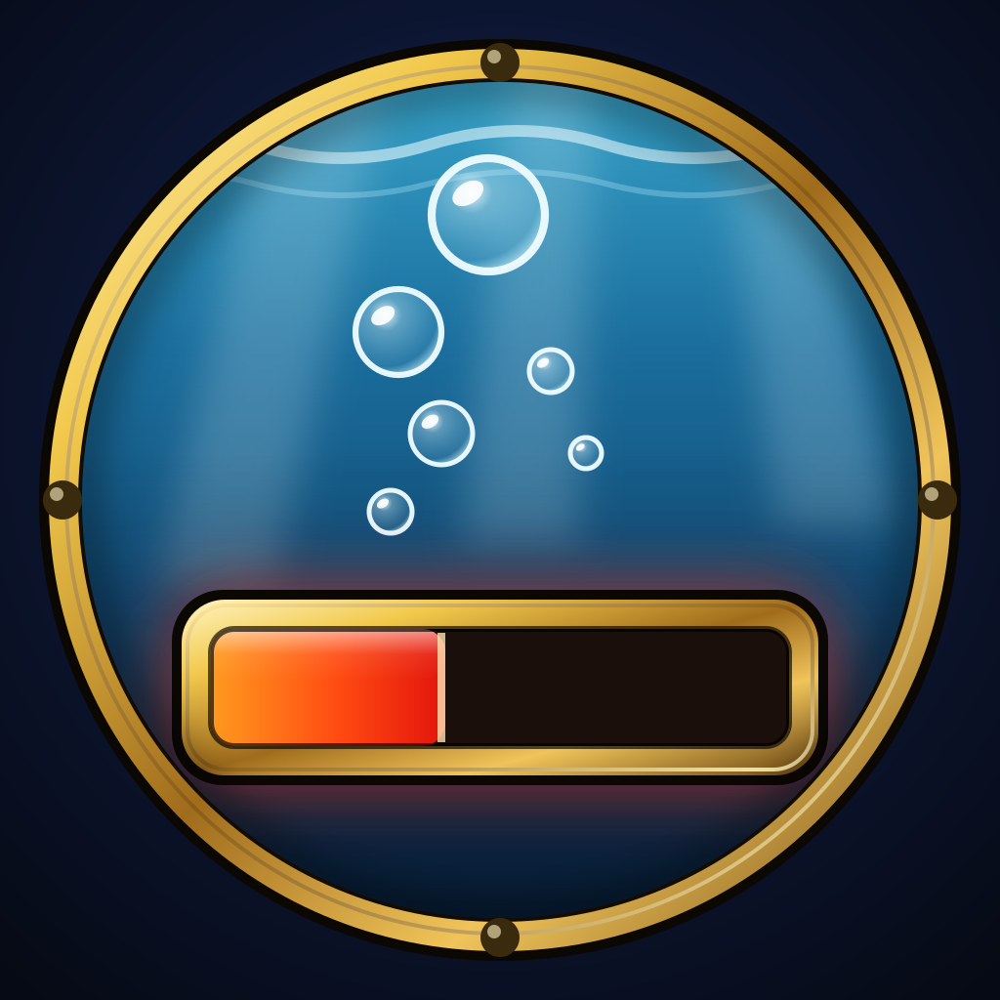
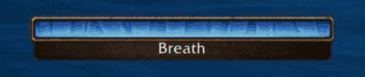

<p align="center">
  
</p>

<h1 align="center">Lungful</h1>

<p align="center">
  A World of Warcraft: Forever addon that turns the breath bar yellow, orange, then red and flashing, so you swim back up before you drown.
</p>

<p align="center">
  <a href="https://github.com/dremex/Lungful/actions/workflows/test.yml"></a>
  <a href="LICENSE"></a>
</p>

<p align="center">
  
</p>

## Why

The breath bar looks the same at 59 seconds left as it does at 5. It's easy to get caught up looting a wreck or chasing a quest item and miss it entirely. Lungful leaves the bar alone while you have plenty of air, then makes it impossible to ignore as you run out.

## What it does

| Breath left | The bar |
| --- | --- |
| Above 70% | Blizzard's usual blue |
| 70% to 50% | A faint yellow that deepens to full yellow |
| 50% to 40% | Steps toward orange, then shifts to full orange |
| 40% to 30% | Steps toward red, then shifts to full red |
| 30% to 25% | Solid red |
| 25% to 10% | The red fill flashes, faster as breath runs out |
| Under 10%, and drowning | The whole bar flashes fast, with what's left still showing between flashes |

When you surface and breath refills, the stock bar comes straight back. The fatigue bar in deep water gets the same treatment, since swimming back works the same way there.

## Install

1. Download `Lungful-X.Y.Z.zip` from the [latest release](https://github.com/dremex/Lungful/releases/latest).
2. Unzip it into `World of Warcraft/_forever_/Interface/AddOns`, so you end up with `AddOns/Lungful/Lungful.toc`.
3. Restart the game or type `/reload`.

Lungful is for WoW: Forever only. It's built against that client's breath bar, which Classic Era and retail draw differently.

## Options

Open **Options > AddOns > Lungful**, type `/lungful`, or click Lungful in the addon menu by the minimap. Right-click it there to preview a dive.

- **Turn red:** at a set share of breath (30% unless you change it), or from how long you've been under water. The second option turns red when swimming back the way you came would reach air with a few seconds to spare: on a full 60 second bar with 5 spare seconds, that's at 32 seconds left. Either way, a faint yellow starts 40% of the bar before the red point and orange 20% before it, and flashing starts 5% after it.
- **Flash near the end:** turn off for a steady red bar.
- **Color the fatigue bar:** turn off to leave the fatigue bar alone.
- **Preview:** plays a sped-up dive on a sample bar so you can see every stage without drowning.

### Commands

```
/lungful                   open the options
/lungful help              current setting and commands
/lungful test              watch a sped-up dive
/lungful percent <number>  red at that percentage of breath left (5-95)
/lungful trip [seconds]    red from how long you've been under, with that many spare seconds (0-30)
/lungful flash on|off      flash near the end
/lungful fatigue on|off    color the fatigue bar too
/lungful debug             what Lungful sees, for bug reports
```

## Questions

**Why not use how deep I am?** The game doesn't tell addons your depth, only how much breath is left. The "how long you've been under" option is the closest stand-in: if getting here took 20 seconds of breath, getting back the same way takes about 20 too.

**Does it change Blizzard's breath bar?** No. Lungful lays its own textures over the bar and never changes Blizzard's textures, colors or code, so it can't break the default UI. When its overlay is hidden, the bar is exactly as Blizzard drew it.

**Does it cost frame rate?** Only while a breath or fatigue bar is up. The rest of the time it does no work at all.

## Development

You need [LuaJIT](https://luajit.org) and Node.js (the formatter, [StyLua](https://github.com/JohnnyMorganz/StyLua), runs through `npx`).

```
luajit tests/run.lua     # must end "N passed, 0 failed"
tools/format.sh          # format the Lua (add --check to only check)
```

`tests/run.lua` loads the addon's real files against a mocked WoW API in `tests/wow_mock.lua`. The mock's breath bar and options panel follow `Blizzard_MirrorTimer` and `Blizzard_Settings_Shared` from the 1.60.1 Forever client, so the tests catch the mistakes that would otherwise only show up in game. They also check that Lungful only reads Blizzard's frames and adds no stray globals.

| File | What it holds |
| --- | --- |
| `Lungful/Core.lua` | Settings, and the math that picks a color and flash rate for each moment |
| `Lungful/Tracker.lua` | Following the game's breath and fatigue timers and painting the overlay |
| `Lungful/Preview.lua` | The sample bar for `/lungful test` |
| `Lungful/Options.lua` | The Options > AddOns page |
| `Lungful/Commands.lua` | `/lungful` and the addon menu entry |

To try a change in game, link the addon folder into the game instead of copying it:

```
ln -s "$PWD/Lungful" "/Applications/World of Warcraft/_forever_/Interface/AddOns/Lungful"
```

The code is WoW's Lua 5.1, with no comments outside the tests: names and structure carry the meaning. Function bodies are split into paragraphs with blank lines. Consecutive `local` bindings stay together, a binding that spans several lines ends its paragraph, runs of the same kind of statement stay together, and every other statement or block gets its own paragraph.

### Releasing

1. Add the release's notes to `CHANGELOG.md` under a `## X.Y.Z` heading and commit.
2. Run `tools/release.sh X.Y.Z`. It checks formatting and tests, tags `vX.Y.Z`, builds `dist/Lungful-X.Y.Z.zip` with the version stamped into the TOC, and offers to push. Pushing the tag runs a workflow that posts the GitHub release with the zip and notes.
3. Upload the same zip to CurseForge for WoW: Forever.

`tools/package-addon.sh` builds a tester zip from any commit.

## License

[MIT](LICENSE)
