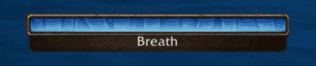

The breath bar looks the same at 59 seconds left as it does at 5. It's easy to get caught up looting a wreck or chasing a quest item and miss it entirely. Lungful leaves the bar alone while you have plenty of air, then makes it impossible to ignore as you run out.

Made for World of Warcraft: Forever.

## What it does

| Breath left | The bar |
| --- | --- |
| Above 70% | Blizzard's usual blue |
| 70% to 50% | A faint yellow that deepens to full yellow |
| 50% to 40% | Steps toward orange, then shifts to full orange |
| 40% to 30% | Steps toward red, then shifts to full red |
| 30% to 25% | Solid red |
| 25% to 10% | The red fill flashes, faster as breath runs out |
| Under 10%, and drowning | The whole bar flashes fast, with what's left still showing between flashes |

When you surface and breath refills, the stock bar comes straight back. The fatigue bar in deep water gets the same treatment, since swimming back works the same way there.

## Options

Open **Options > AddOns > Lungful**, type `/lungful`, or click Lungful in the addon menu by the minimap. Right-click it there to preview a dive.

- **Turn red:** at a set share of breath (30% unless you change it), or from how long you've been under water. The second option turns red when swimming back the way you came would reach air with a few seconds to spare: on a full 60 second bar with 5 spare seconds, that's at 32 seconds left. Either way, a faint yellow starts 40% of the bar before the red point and orange 20% before it, and flashing starts 5% after it.
- **Flash near the end:** turn off for a steady red bar.
- **Color the fatigue bar:** turn off to leave the fatigue bar alone.
- **Preview:** plays a sped-up dive on a sample bar so you can see every stage without drowning.

## Commands

```
/lungful                   open the options
/lungful help              current setting and commands
/lungful test              watch a sped-up dive
/lungful percent <number>  red at that percentage of breath left (5-95)
/lungful trip [seconds]    red from how long you've been under, with that many spare seconds (0-30)
/lungful flash on|off      flash near the end
/lungful fatigue on|off    color the fatigue bar too
/lungful debug             what Lungful sees, for bug reports
```

## Questions

**Why not use how deep I am?** The game doesn't tell addons your depth, only how much breath is left. The "how long you've been under" option is the closest stand-in: if getting here took 20 seconds of breath, getting back the same way takes about 20 too.

**Does it change Blizzard's breath bar?** No. Lungful lays its own textures over the bar and never changes Blizzard's textures, colors or code, so it can't break the default UI. When its overlay is hidden, the bar is exactly as Blizzard drew it.

**Does it cost frame rate?** Only while a breath or fatigue bar is up. The rest of the time it does no work at all.

## Source and bug reports

Lungful is open source under the MIT license. The code, the changelog and bug reports live on [GitHub](https://github.com/dremex/Lungful). If something looks wrong, run `/lungful debug` and include what it prints in an [issue](https://github.com/dremex/Lungful/issues).
